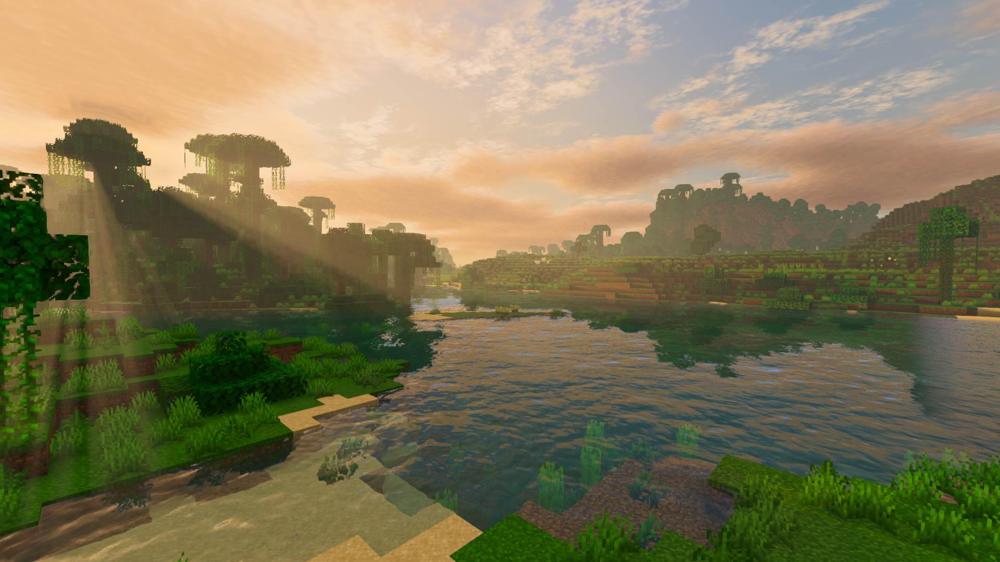
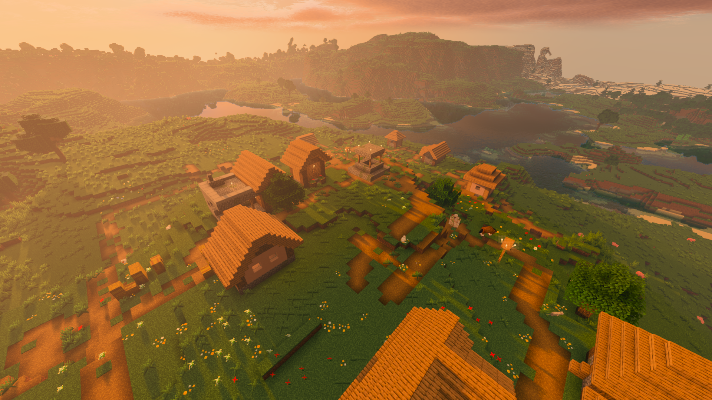
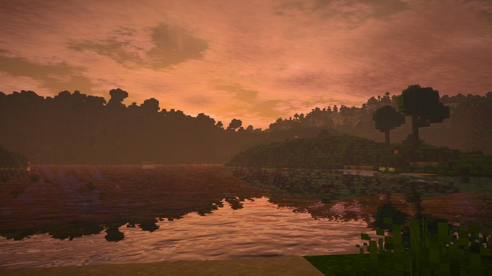
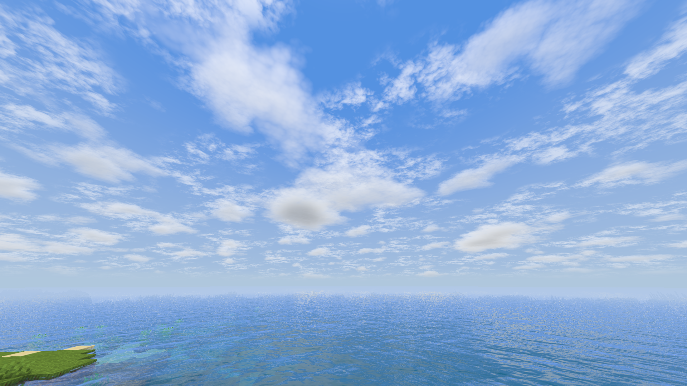
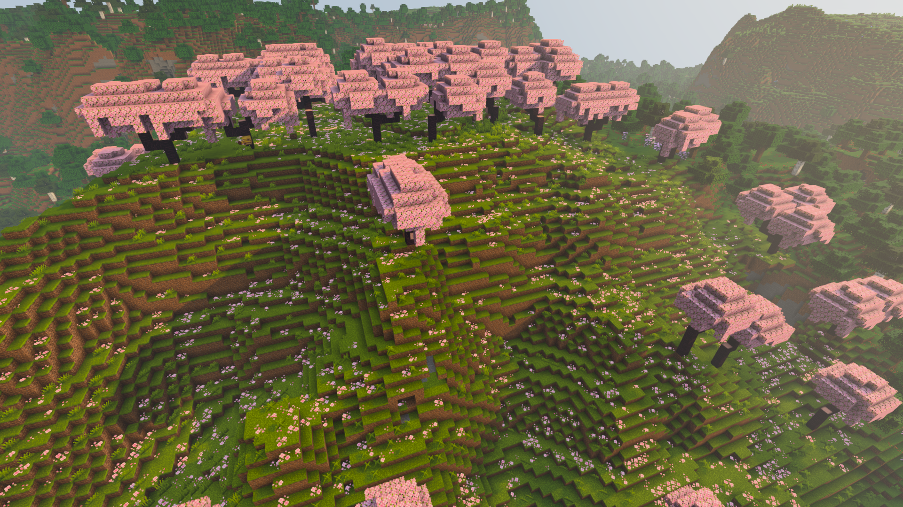
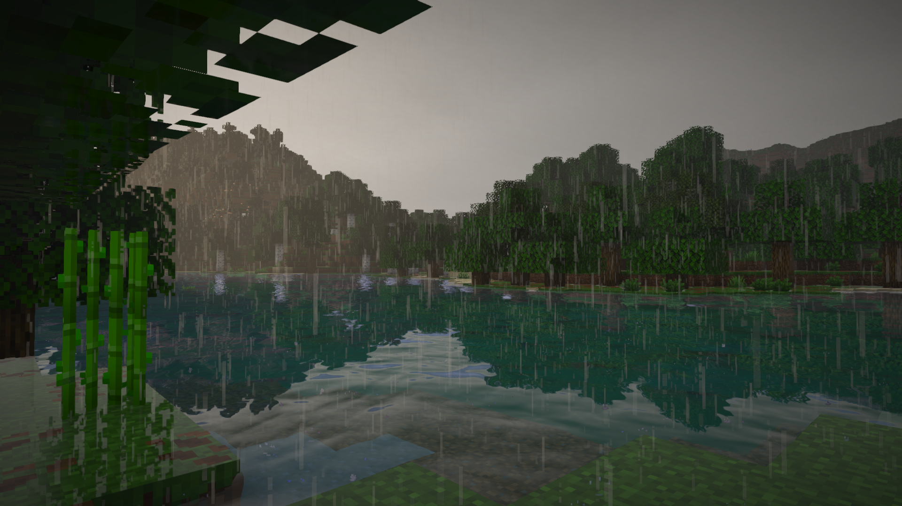
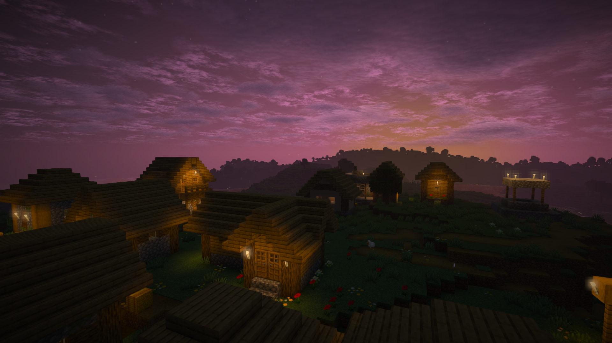

# Plume Shader



A standalone **raster-only** shader pack for Horizon Rust Minecraft (`plume_shader`, **Beta**) with golden-hour sunlight, volumetric clouds, directional sky and aerial haze, colored volumetric block lights, colored dynamic lighting, waving foliage, sun shafts, wet and polished surfaces, planar water mirror + SSR, custom rain and snow, bloom, and optional edge smoothing. Ordinary Minecraft textures are enough. See [TUNING.md](TUNING.md) for palette and effect controls.

## Showcase

| World Lighting | Water & Sunset |
| --- | --- |
|  |  |

| Volumetric Clouds | Biomes & Landscapes |
| --- | --- |
|  |  |

| Weather | Night & Cave Lighting |
| --- | --- |
|  |  |

## Install

1. Download/copy `dist/plume_shader-0.7.8.hshader` into your Horizon game folder's `shaderpacks/` directory, beside `options.txt`. Use **Open Pack Folder** in Horizon to find the correct instance. Move previous full-pack versions out of that directory to avoid duplicate ids.
2. Open **Options > Video Settings > Shaders > Shader Packs**, then select **Plume Shader**.
3. Open the pack's settings screen and choose one of the four **Quality preset** options (**Lite**, **Balanced**, **High**, or **Ultra**). Core lighting colours, contrast, and strengths are locked to the pack's tuned look across all presets. To light the world from held and dropped light items, also make sure Horizon's **Dynamic Lights** setting is enabled in Video Settings.
4. For the round moon and clear translucent rain splash particles, put [Horizon Lighting Resources](dist/horizon-lighting-resources.zip) in `resourcepacks/` and enable it in **Options > Resource Packs**. It includes all eight lunar phases and soft neutral rain splashes matching the shader's custom rain streaks.

For development, copy the **whole** `horizon_lighting/` folder into `shaderpacks/` instead. Horizon watches that folder and reloads edits. Install one copy of the pack, either folder or archive.

This is Horizon's native **shader API 0.2** format (finalized at Preview stability). Use a client that serves finalized API 0.2 (`Nightly 2026-11-18` or newer). This is not an Iris/OptiFine shader pack. Implementation/checker source baseline: [`0a875da91dbb0fdcb7ba8c42c11341aa229af51a`](https://github.com/horizon-rust/horizon/tree/0a875da91dbb0fdcb7ba8c42c11341aa229af51a) (Nightly 2026-11-20), inspected November 21, 2026.

### Which client build?

The pack runs on a client built from the baseline above or a compatible newer version. The local client reports **Nightly November 16, `85b5bcca`**. The slot's folder/launcher label can still say November 13 because it was replaced in place. See [local upgrade and restore instructions](validation/LOCAL-CLIENT.md).

Building the newer client is separate from building this shader. The local upgrade built `horizon-official` (upstream's shipped client), `horizon-ctl`, and `horizon-prepare` with the optimized `fast` profile, MSVC x64, and static C runtime. `HORIZON_GAME_BUILD_ID` was set to the exact commit because the checkout's Windows ownership prevented a build script's plain git command. The source checkout stayed unchanged. New prepared data was required; replacing the executable alone was insufficient.

## Quality presets

The pack ships with a single in-game **Quality preset** selector (default: **Balanced**) and no manual slider clutter. Core lighting colours, contrast, surface gloss, wetness, water character, and aerial perspective stay consistent across every preset.

| Setting | Lite (Maximum performance) | Balanced (Recommended, default) | High (Enhanced visual quality) | Ultra (Maximum visual fidelity) |
| --- | --- | --- | --- | --- |
| Shadow map | 2048 px, 96-block coverage | 2048 px, 96-block coverage | 2048 px, 96-block coverage | 2048 px, 96-block coverage |
| Shadow filter | 1 tap (engine bilinear) | 5 taps | 9 taps | 9 taps |
| Clouds | Fast single cloud plane | Volumetric (10 / 4 steps) | Volumetric (12 / 6 steps) | Volumetric (16 / 8 steps) |
| Sun shafts | 8 samples | 16 samples | 20 samples | 28 samples, maximum-strength beams (82-block reach) |
| Water mirror | On | On | On | On |
| Reflected scenery (SSR) | Off | On (12 steps) | On (18 steps) | On (24 steps) |
| Contact ambient occlusion | Off | On | On | On |
| Surface micro-relief | Off | On | On | On |
| Waving foliage | Off | On | On | On |
| Bloom | Off | On | On | On |
| Edge smoothing | Off | On | On | On |

Shadow coverage is the half-side of Horizon's shadow square in blocks (fixed at 2048 px / 96 blocks so every preset keeps crisp cast shadows and the planar water mirror). **Ultra** raises sun-beam reach, integration samples, strength, and highlight headroom so golden-hour crepuscular rays stay vivid and distinct through trees and terrain.

The RTX 4050 is a useful target for Balanced, High, and Ultra, while Lite skips SSR, volumetric clouds, contact AO, bloom, foliage wind, micro-relief, and spatial AA for maximum speed. `[budget] gpu_ms = 4.0` is an authoring target, not a measured result or an enforced runtime cap.

## Rendering choices and limits

- The Overworld shares a directional sky palette across terrain, clouds and haze. Terrain uses its original texture colors and biome tints. In low sun, exposed leaf sides share the crown's diffuse light and open canopy shade takes on cool skylight. A fixed-exposure grade shapes midtones and rolls off highlights while preserving their color ratios. Regular and wall torches cast warm amber light. [Matched crown and side comparisons](validation/0.5.8/REVIEW.md)
- The sun's bright core blends into glare behind the volumetric clouds. Cloud lobes change shape with altitude, and the shader blends into a filtered layer at grazing angles. Rain adds occasional larger banks with breaks between them. Clear-weather clouds transmit enough light for terrain and entity shadows. The optional round moon uses the client's lunar draw, including its weather fade. [Cloud comparisons](validation/0.5.14/REVIEW.md)
- The Nether uses warm ambient light and sharper separation between lava, fire, glowstone and nearby terrain. The End uses cool, low ambient light and subdued local accents. Both retain the engine sky and fog palette. The pack uses the engine lightmap and sky when the client reports the custom-dimension ID. Sun shafts and wetness are scoped to the Overworld ID.
- **Atmosphere → Waving foliage** animates grass, ferns, flowers, crops, vines, aquatic plants, and tree leaves in the `[vertex]` stage, keeping shadows aligned with moving foliage. Clear weather uses a gentle breeze, while rain and thunder smoothly ramp up both speed and intensity outdoors without phase jumps or cave movement. **Wind strength** scales the amplitude, and distant foliage fades smoothly to static beyond 96 blocks.
- **Rain and snow (`[weather]`)** replaces vanilla's saturated blue rain with translucent, sky- and torch-lit water streaks and softly lit snowflakes.
- **Lighting → Dynamic lighting** illuminates nearby terrain, entities, and water from held and dropped light items using the same `[[lights]]` colors as placed light sources (requiring Horizon's client **Dynamic Lights** setting to be enabled), capped so multiple nearby items don't stack additively. **Dynamic light strength** controls its brightness.
- **Atmosphere → Aerial perspective** lets distant Overworld terrain, mobs, and block entities take on the horizon color, with denser haze at lower elevations. The default is 0.5. Set it to zero to turn off this haze. **Experimental fog** adds an independent distance tint. The client still handles environmental fog on entities.
- The water mirror is Horizon's **horizontal, half-resolution planar reflection**: solid terrain over vanilla's sky gradient. It is not a general mirror of entities, custom sky, sun/moon/stars, or every water elevation. Mirror contributions fade near screen edges and incompatible plane heights, and are disabled underwater and on side faces.
- Water uses clear transmission by default. The Water clarity slider can add depth absorption. Ripples only affect upward-facing surfaces. Sheltered pools reflect local lights, and falling water has a translucent edge that stays visible in dark caves.
- Submerged terrain and the distant background use a muted haze. Nearby mobs and block entities compensate for the blue fog the client still applies after the entity stage. Daylight creates soft moving rays where it passes through water. The **Underwater sun rays** slider controls their strength.
- Top faces on selected metals, polished solids, and rain-wet blocks use optional screen-space scenery reflections. The Overworld also uses GGX sun and moon highlights and a subdued fallback for offscreen reflections. Metal tops pick up material-tinted reflections from local block light.
- Exposed Overworld block sides borrow diffuse light from the top face and catch mid-distance glints colored by their material. Grass and leaves pick up colored backlighting from the sun and moon. **Lighting → Sunlight color** adjusts the sun's RGB tint. **Lighting → Night brightness** scales moonlight. **Gloss and reflected light → Dry light response** adjusts the highlights and backlighting from both.
- Sun and moon shafts sample the shadow map at half resolution and use depth-aware upsampling. Terrain and entities use the 3D block-light color field, weighted by the engine's propagated light level. Receivers at the lowest block-light levels reject the placed-light color and its airborne glow. Full per-source occlusion requires geometry or a color field that includes occlusion in the client.
- Quarter-resolution bloom adds a soft halo to aligned sun reflections and to visible edges of sunlit leaves and grass at grazing angles. Solar bloom carries the sun's color with a subtle material tint. Bright emitters also bloom. Edge smoothing is a spatial FXAA-style pass that can soften fine detail. Horizon's normal TAA/FXAA/upscaling settings do not run while this pack owns the post chain. Disable **Edge smoothing** for sharper aliased edges.
- First-person hands, dropped/framed items, particles, and some special effects retain Horizon's lighting, according to API 0.2 stage coverage. Engine shadow caster visibility and distance limits still apply.
- No temporal history, camera jitter, global illumination, arbitrary mirrors, or coloured-glass shadow filtering in this release.

## Validation

The official `horizon-shader` CLI was built from the baseline above with a minimal standalone workspace, Rust 1.100.0 (Windows GNU), and the dependency lockfile in `validation/checker-Cargo.lock`. Upstream Rust source is kept separately under ignored `.tools/upstream/`, with its original licence, and is not part of the shader distribution. The shader code itself is MIT licensed.

Run on Windows with Python 3.11+ and the official checker:

```powershell
.\tools\check.ps1 -Package
# Or supply an existing checker:
.\tools\check.ps1 -Checker C:\path\to\horizon-shader.exe -Package
```

Portable equivalent:

```sh
python tools/validate.py --checker /path/to/horizon-shader --package
```

To build the checker yourself, obtain the pinned Horizon revision and run `cargo build -p horizon-shader-api --bin horizon-shader --release`. A full Horizon checkout supplies its workspace configuration. For exact dependency versions use the recorded lockfile with a standalone workspace containing only `crates/horizon-shader-api`, edition 2024, Rust version 1.95, and workspace licence `LGPL-3.0-or-later`. No changes to upstream checker Rust source are needed.

The validation script checks the default pack, all four presets (Lite, Balanced, High, Ultra), and the main archive. Horizon translates each stage for **Vulkan/SPIR-V, Metal/MSL, and DirectX/HLSL** at default, minimum, and maximum option values. Package tests check raster dependencies, fixed engine passes, preset-only UI contracts, target ordering, reachable settings, and archive/source equivalence. Results are in `validation/checker.json`.

GPU regression tests exercise production WGSL for water, surface lighting, dimension routing, and entity fallbacks. Results are in `validation/gpu-adapters.json`. Install the optional test runtime locally with `python -m pip install --target .tools/pythonlibs wgpu==0.33.0`.

After the user enabled agent control, the **compatibility archive** was visually checked in an isolated offscreen test world on Nightly November 13 (`9f42064`), Vulkan, RTX 4050, with ray tracing explicitly disabled and `HORIZON_HDR_FRAME=float`. Captures in `validation/previews/` show daylight cast shadows, sea-level planar reflections, night/torch lighting, water from below, and rain. The artificial pool sits at a different level from the surrounding lake, so it deliberately uses the non-mirror fallback. The normal instance's worlds/options and the Horizon checkout were not changed.

The golden/gloss 0.2.0 iteration was visually checked in daylight, dawn/dusk, glossy terrain, night and underwater fixtures on the November 16 client. Its captures, short benchmark and installed archive details are in `validation/golden/` and `validation/latest-client-runtime.json`.

The 0.3.5 captures cover the Overworld, Nether and End on the November 16 client with Vulkan and ray tracing disabled. The pinned client reports only the three vanilla dimension IDs. The GPU regression injects ID 2 to exercise the custom-dimension fallback. [Validation and captures](validation/0.3.5/REVIEW.md)

The 0.3.6 captures compare the underwater effect on and off and show what happens when a solid roof blocks the sun. [Water validation and captures](validation/0.3.6/REVIEW.md)

The 0.4.0 captures compare the directional sky and natural greens against 0.3.9. The 0.4.2 captures compare rain, low-sun terrain, shorelines, and submerged views against 0.4.1. [Sky validation](validation/0.4.0/REVIEW.md) · [Rain and haze validation](validation/0.4.2/REVIEW.md) · [Next-session handoff](docs/NEXT-SESSION.md)


### In-game visual checklist

- Daylight: inspect leaves, roof/pillar shadows, entity shadows, shadow-map boundaries, and distant terrain for acne, detached shadows, and abrupt seams.
- Sunrise/sunset and moonlight: check colour, transition, and nighttime readability. Check a torch-lit room and cave entrance.
- Water: inspect terrain reflections and ripples from above; enter water, look through waterfalls, and compare water at different heights. Transparency should remain readable.
- Rain/thunder: shafts and direct sunlight should weaken. Nether/End should retain their normal light and fog.
- Toggle shadows/reflections/shafts/bloom individually; compare Low/Balanced/High. Check night vision, darkness, and blindness.
- Use the same scene, resolution, render distance, weather, and camera for performance comparisons. Horizon's F3 GPU timing is useful; record the engine shadow/mirror costs as well as the named post passes.

## Layout

`horizon_lighting/` is the complete pack source; `dist/` holds the installable archive; `tools/` contains validation scripts; `tests/` checks distribution contracts; `validation/` holds machine-readable evidence. Design and implementation notes live in `docs/superpowers/`.

References: [authoring guide](https://github.com/horizon-rust/horizon/blob/0a875da91dbb0fdcb7ba8c42c11341aa229af51a/docs/api/shaders.md), [API reference](https://github.com/horizon-rust/horizon/blob/0a875da91dbb0fdcb7ba8c42c11341aa229af51a/docs/api/shaders-reference-0.2.md).
